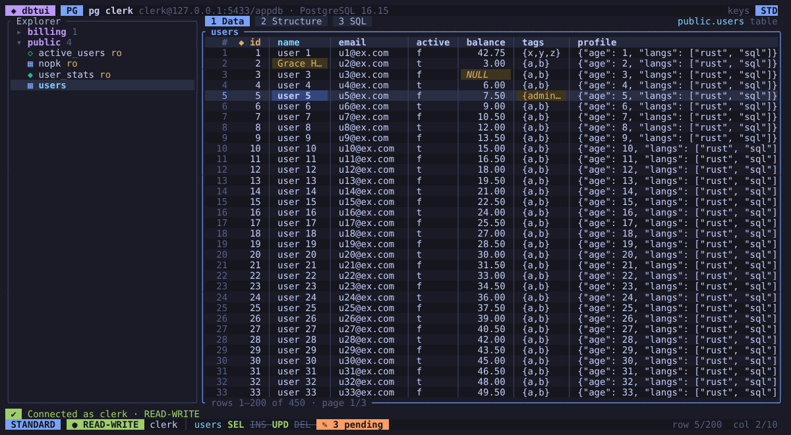
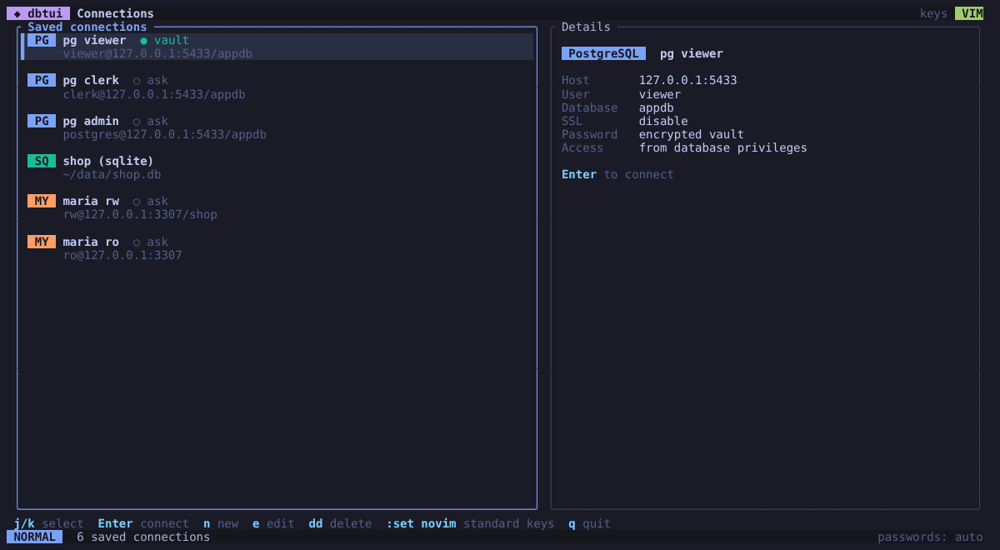
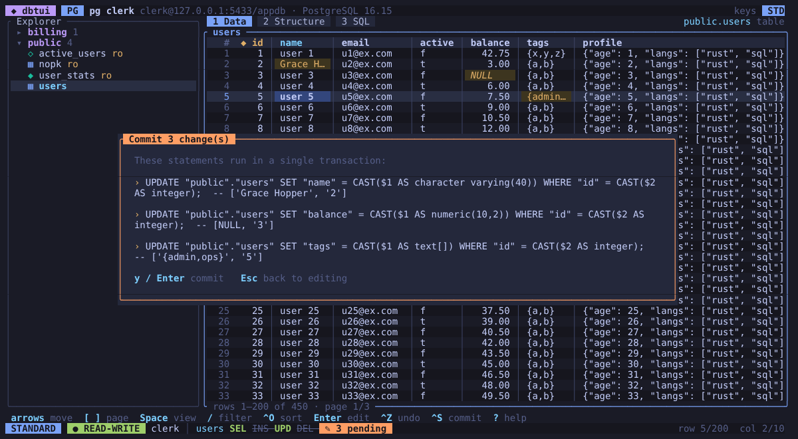
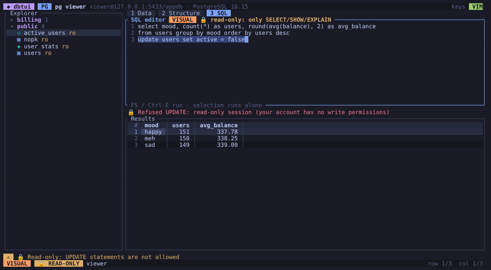

# dbtui

A terminal UI for exploring and editing SQL databases, built with Rust and
[ratatui](https://ratatui.rs). It supports **PostgreSQL**, **MySQL / MariaDB** and **SQLite**.



## Features

- **Explore schemas**: schemas, tables, views and materialized views in a filterable tree.
  The Structure tab lists columns, types, defaults, keys and indexes.
- **Browse data**: a fast spreadsheet-style grid with paging, sorting, SQL `WHERE` filters,
  a full-value viewer (JSON is re-indented, nothing else about it changes) and copy to the
  system clipboard (OSC 52). Copying always copies the stored value; a `NULL` copies nothing.
- **Edit data safely**: edit cells, set `NULL`, add rows and delete rows. Changes are *staged*
  and highlighted, and you can undo them. Committing first shows a preview of the generated SQL,
  then runs everything in **one transaction**. Each update or delete targets exactly one row by
  primary key, and if any statement would touch a different number of rows, the whole commit is
  rolled back. Values go through the database's normal checks, so one that does not fit the
  column (too long for `varchar(n)`, say) is rejected rather than cut short. MySQL tables on an
  engine without transactions (MyISAM, MEMORY…) cannot be rolled back: the preview warns about
  this, and committing several changes to them needs an explicit `!`. See
  [How edits reach the right row](#how-edits-reach-the-right-row).
- **SQL editor**: a multi-line editor with a result grid. You can run the whole buffer or only
  the selection.
- **Vim or standard keys**: arrows/F-keys/Ctrl shortcuts by default, or a vim-style scheme
  (`hjkl`, `gg`/`G`, `dd`, `yy`, `p`, `u`, `:w`, `:q`, a modal SQL editor…). Switch with
  `Ctrl-K`, `:set vim` / `:set novim` or `--vim`. The choice is remembered.
- **Secure credentials**: passwords are never written to the config file. They go to the OS
  keyring (macOS Keychain, Windows Credential Manager, Secret Service on Linux). When no keyring
  is available (servers, containers, WSL), they go to an encrypted vault instead. The vault uses
  Argon2id for the key and XChaCha20-Poly1305 for the data, and is unlocked once per session
  with a master password. A saved password is only ever sent to the server it was saved for.
  See [Saved passwords](#saved-passwords).
- **Permission-aware**: the status bar always shows your access level and your privileges on the
  open table. Read-only users can browse and query, but cannot even start an edit. See below.
- **Verified connections**: new profiles for remote servers check the server's certificate and
  host name (`verify-full`). The status bar shows the TLS version actually negotiated, and dbtui
  warns whenever a remote server is not authenticated. See [Connection security](#connection-security).

## Permissions

When you connect, dbtui works out what you are allowed to do:

| Database   | Session-wide read-only when…                                             | Per-table privileges from              |
|------------|--------------------------------------------------------------------------|----------------------------------------|
| PostgreSQL | `default_transaction_read_only` is on, or the server is a hot standby    | `has_table_privilege` / schema `USAGE` |
| MySQL      | `super_read_only`, `read_only` (for non-SUPER users), read-only sessions | `SHOW GRANTS` (including active roles) |
| SQLite     | the file is not writable, or `PRAGMA query_only` is set                  | everything if the file is writable     |

A profile can also be marked **Read-only**. The server then enforces it too:
`default_transaction_read_only` on PostgreSQL, `SET SESSION TRANSACTION READ ONLY` on MySQL, and
a read-only open on SQLite.

The status bar shows the result:

- `🔒 READ-ONLY`, `● READ-WRITE` or `● SUPERUSER` for the session;
- `SEL INS UPD DEL` for the open table, with privileges you don't have crossed out;
- a `ro` tag next to every table you cannot modify in the explorer.

Without the right privilege, the edit, delete and insert keys do nothing except show a short
explanation, and their hints disappear from the footer. Rows can only be edited or deleted when
the table has a primary key.

### What read-only covers

In a read-only session (a profile marked read-only, `--read-only`, a read-only server, or an
account without write privileges):

- edits cannot be staged or committed;
- the SQL editor refuses, before sending anything, every statement that writes, changes
  settings (`SET`, `set_config()`, `PRAGMA name = value`) or controls transactions (`BEGIN`,
  `COMMIT`, `ROLLBACK`…), as well as text it cannot check reliably (an unterminated string or
  comment, MySQL `/*! … */` comments);
- as a second safeguard, everything that is sent (SQL editor queries, page loads and row counts,
  including table filters) runs inside a read-only transaction that is always rolled back
  (`PRAGMA query_only` on SQLite), so the database itself rejects writes.

Table filters are checked in every session: a filter must be a single condition, without `;`,
comments or unbalanced parentheses. The checks follow each database's quoting rules, including
settings that change them (`standard_conforming_strings`, MySQL `NO_BACKSLASH_ESCAPES` and
`ANSI_QUOTES`).

Read-only mode does not stop side effects that a database allows inside a read-only
transaction: advisory locks (`pg_advisory_lock`, MySQL `GET_LOCK`), functions that work through
another connection (`dblink`) or outside the database (untrusted procedural languages), and
anything else a server-side function may do. Those are governed by the account's privileges.
For a hard guarantee, connect with an account that can only read.

## How edits reach the right row

Rows are identified by their primary key, never by where they are on screen:

- **Keys are matched exactly as stored.** Binary keys are sent as bytes, not as the `0x…` text
  the grid shows, and SQLite keys keep their storage class: in a column without type affinity,
  integer `1` and text `'1'` are different rows that look the same. A row whose key is not shown
  exactly as stored (text that is not UTF-8, a MySQL `BIT` value) cannot be changed from the
  grid; use the SQL editor. Binary values themselves cannot be edited as text either.
- **The cell editor remembers its row and column**, not their position. If the table is
  reloaded while it is open, the value goes to the same row wherever it now is, or, if the row
  is gone, the editor closes without staging anything. Confirming without a change stages
  nothing, and line endings (CRLF, a final newline) are kept.
- **Nothing can be staged while a page is loading or a commit is running**, and reloading,
  sorting, filtering or paging waits until staged changes are committed or discarded. Staged
  changes are never dropped by a reload.
- **A commit preview is tied to what it shows**: it only commits to the connection and table it
  was made for, and only while the staged changes are the ones shown. While a commit runs, a
  second one, discarding, and opening another table wait for its result; afterwards exactly
  the committed changes are cleared and the table is reloaded, whichever tab is shown. Quitting
  or disconnecting during a commit warns that it may still be applied, and after a disconnect
  its result is still reported.
- **Results of earlier requests are dropped**: a connection that finishes after you asked for
  another one is closed, and pages, counts, schema lists and query results from a connection
  you have left never reach the current one.

After a statement in the SQL editor that may have written, the open table is reloaded (or, with
staged changes, dbtui warns that their rows may have changed).

## Connection security

The SSL mode of a profile uses the libpq names. With dbtui's driver (sqlx), only `verify-full`
proves that you are talking to the right server:

| Mode          | Encrypted            | Server authenticated                                        |
|---------------|----------------------|-------------------------------------------------------------|
| `disable`     | no                   | no                                                          |
| `prefer`      | if the server agrees | no: any certificate is accepted, and TLS can be refused     |
| `require`     | yes                  | no: any certificate is accepted                             |
| `verify-ca`   | yes                  | partly: the certificate chain is checked, not the host name |
| `verify-full` | yes                  | yes: a trusted certificate for the host name you typed      |

Without authentication, anyone who can intercept or redirect the connection (shared Wi-Fi, a
spoofed DNS name, a compromised router) can pose as the server and receive the password,
including one saved in the keyring or vault. So:

- **Defaults**: a new profile uses `verify-full`, or `prefer` when the host is `localhost`, a
  loopback address or a Unix socket directory. A profile written without `ssl_mode` gets the
  same default. Saved modes are kept as they are.
- **Warnings**: the connection form, the connection list, the connect message and the status
  bar warn when a remote profile uses `disable`, `prefer`, `require` or `verify-ca`.
- **What was negotiated**: the status bar shows the transport the server reports (`pg_stat_ssl`
  on PostgreSQL, `Ssl_version` / `Ssl_cipher` on MySQL): `✓ TLSv1.3 verified`,
  `⚠ TLSv1.3 unverified`, `⚠ NOT ENCRYPTED`, or a plain `no TLS` / `socket` for local
  connections. `Ctrl-T` in the form reports it too.
- **Private CAs**: certificates are checked against the Mozilla root set built into the driver,
  not the operating system's store. For a server with a private CA (company CA, AWS RDS, Cloud
  SQL, MySQL's self-generated certificates), set **CA file** (`ssl_ca`) to a PEM file. It is
  trusted in addition to the public roots.
- **`verify-ca`** needs a CA file, as in libpq; a profile saved with `verify-ca` and no CA file
  no longer connects. Even then, the public roots stay trusted and the host name is not
  checked, so any publicly trusted certificate passes: prefer `verify-full`. A CA file with
  `disable`, `prefer` or `require` is refused, because those modes ignore it.
- **MySQL cleartext passwords**: sqlx 0.9 sends the password in clear text when the server's
  first packet asks for the `mysql_clear_password` plugin (an upstream bug: its own
  cleartext-plugin setting is not applied there). With `disable` or `prefer`, an attacker on the
  network can therefore read the password. `verify-full` refuses a server that does not
  complete TLS with a valid certificate, so the password only ever goes to the real server.
- **No implicit settings**: connection settings come from the profile only. sqlx would read
  PostgreSQL defaults from `PG*` environment variables (`PGPASSWORD`, `PGSSLCERT` / `PGSSLKEY`,
  `PGSSLROOTCERT`, `PGOPTIONS`, `PGUSER`…), so dbtui removes every `PG*` variable at start-up,
  and it does not read `~/.pgpass`. Client certificates are not supported.
- **SQLite files from elsewhere** are opened with `PRAGMA trusted_schema = OFF` (SQL stored in
  the file, such as views and triggers, may only use functions and virtual tables that SQLite
  marks as safe) and `PRAGMA cell_size_check = ON`. A path starting with `file:` is a file
  name, never an SQLite URI, and extensions cannot be loaded.

## Saved passwords

A password you choose to save goes to the OS keyring or, when there is none (or with
`secret_backend = "vault"`), to the encrypted vault.

- **Bound to their server**: a password is saved together with the driver, host, port and user
  it was entered for, and is only sent there. If a profile is changed to point somewhere else, in
  the form or by editing `config.toml`, connecting asks for the password, says which server the
  saved one belongs to, and saves what you type for the new server. `Ctrl-T` in the form only
  uses the saved password while the form still points to that server. Passwords saved by
  earlier versions do not record their server: they are used for the profile as saved, and saved
  again with their server after the next successful connection.
- **Cleaned up**: deleting a profile removes its password from both the keyring and the vault,
  and a password that moves from one to the other is removed from the first.
- **Slow keyrings**: a keyring waiting for its unlock prompt is not treated as a failure. After
  15 seconds dbtui says so; the password is saved once the keyring answers, and is not put in
  the vault meanwhile. If the profile has been deleted by then, or its password changed or no
  longer to be saved, what the keyring stored is removed again.
- **The vault** (`vault.toml`, next to the config file) derives its key from the master password
  (8+ characters, never stored) with Argon2id, 64 MiB of memory and 3 passes. Vaults made by
  earlier versions (19 MiB, 2 passes) are re-encrypted with these settings when unlocked, and a
  vault file asking for more than 1 GiB, 10 passes or 8 lanes is refused. Creating a vault never
  replaces an existing one, for example one another dbtui instance has just created.
- **In memory**: password fields and decrypted passwords are wiped once used, including the key
  derivation's working memory, and core dumps are disabled on Unix. The database driver keeps
  its own copy of the password while connected.

## Screenshots

| Connection manager | Reviewing staged changes before commit |
|---|---|
|  |  |

A read-only account in the SQL editor: queries run, writes are refused before reaching the server.



## Install

You need a recent stable Rust toolchain (1.94+).

```sh
cargo install --path .
# or
cargo build --release && ./target/release/dbtui
```

## Usage

```sh
dbtui                 # connection manager
dbtui "prod replica"  # open a saved connection by name
dbtui --read-only "prod replica"  # ...without allowing any change, whatever the profile says
dbtui ./app.db        # open a SQLite file directly (add --read-only to be safe)
dbtui --vim           # use (and remember) vim keys
```

Press `n` in the connection manager to add a connection. `Ctrl-T` tests it and `Ctrl-S` saves it.
Press `?` or `F1` anywhere for the full key reference.

### Keys at a glance

| Action             | Standard            | Vim                  |
|--------------------|---------------------|----------------------|
| Move               | arrows, PgUp/PgDn   | `hjkl`, `Ctrl-d/u`   |
| First / last row   | `Ctrl-Home/End`     | `gg` / `G`           |
| Switch panel / tab | `Tab`, `1` `2` `3`  | `Tab`, `Ctrl-h/l`, `gt` |
| Next / prev page   | `]` / `[`           | `]` / `[`            |
| Filter / sort      | `/` / `Ctrl-O`      | `/` / `s`            |
| View / copy cell   | `Space` / `Ctrl-C`  | `v` / `yy`           |
| Edit cell          | `Enter`, `F2`       | `i`, `Enter`         |
| Set NULL           | `Backspace`         | `x`                  |
| New row / delete   | `Insert` / `Delete` | `o` / `dd`           |
| Undo staged change | `Ctrl-Z`            | `u`                  |
| Commit             | `Ctrl-S`            | `:w`                 |
| Run SQL            | `F5`, `Ctrl-E`      | `F5`, `Ctrl-E`       |
| Quit               | `Ctrl-Q`            | `:q`                 |

## Configuration

Settings live in `config.toml` in the platform config directory (for example
`~/.config/dbtui/` on Linux). Set `DBTUI_CONFIG_DIR` to use a different directory. The file never
contains passwords. Like the vault, it is replaced atomically by a new, randomly named file that
only you can read (`0600`); a missing config directory is created `0700`. Several dbtui instances
can share the directory: each change is made, under a lock (`config.lock`, `vault.lock`), to the
file as it is on disk, so an instance never overwrites what another one saved.

```toml
keymap = "vim"            # or "standard"
page_size = 200           # rows per page
secret_backend = "auto"   # "auto" (keyring, then vault), "keyring" or "vault"

[[connection]]
id = "3f9c2a7e1b4d5c60"   # stable id, used as the credential key
name = "local postgres"
driver = "postgres"       # "postgres", "mysql" or "sqlite"
host = "localhost"
port = 5432
user = "app"
database = "app"
ssl_mode = "prefer"       # disable, prefer, require, verify-ca, verify-full; if left out:
                          # verify-full, or prefer for localhost and sockets
# ssl_ca = "~/certs/db-ca.pem"   # optional: PEM file of a private CA
read_only = false
credential = "keyring"    # where the password is stored: none, keyring or vault
```

The encrypted vault (`vault.toml`) sits next to the config file.

## Development

```sh
cargo test     # unit tests plus end-to-end tests against temporary SQLite databases
cargo clippy --all-targets
cargo fmt
```

The code is organised as:

- `src/db/`: drivers, introspection, permission detection and SQL generation
- `src/app/`: application state, key handling, the staged-edit grid and the SQL editor
- `src/ui/`: rendering, with a Tokyo Night–inspired theme
- `src/secrets.rs`: OS keyring access and the encrypted vault
- `src/keymap.rs`: the standard and vim key schemes
